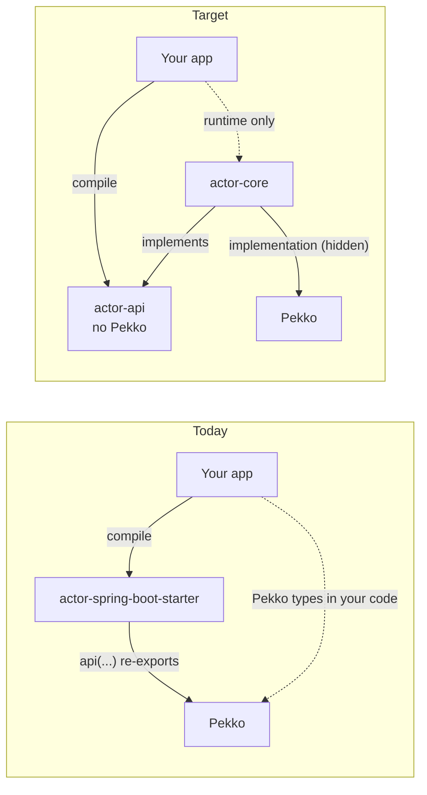
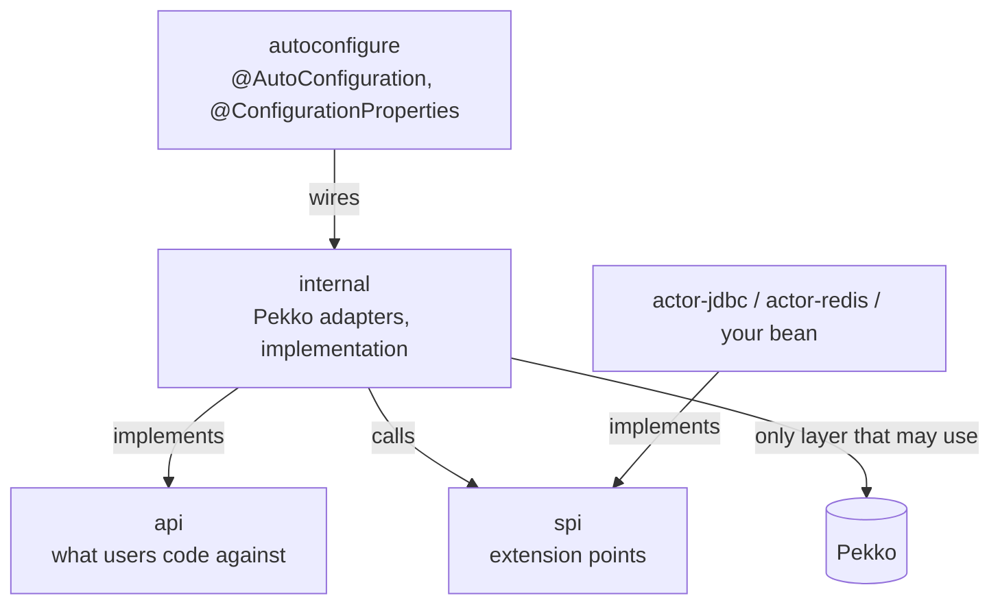
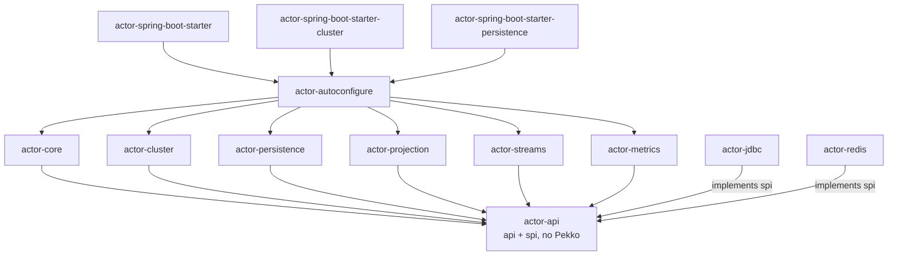
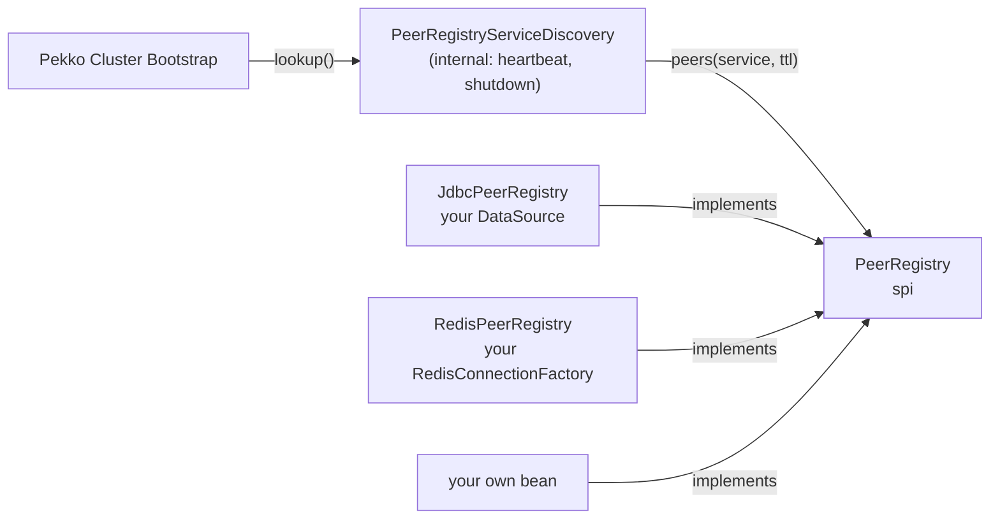

# Architecture

This is the target architecture for 1.0, agreed on 2026-11-08 and tracked in #96. Code that already exists follows it step by step: each sub-issue of #96 moves one part. New code follows it from the start.

## In short

- **Pekko is the engine and an implementation detail.** Users code against the starter's own API, which has no Pekko types. Pekko is a runtime dependency only.
- **One codebase:** Java 21+ and Spring Boot 3+. Boot 2 stays on 0.x.
- **Spring-native everywhere:** typed `@ConfigurationProperties`, Spring executors, Spring's lifecycle, Spring events, Micrometer.
- **Each backend sits behind an SPI.** Databases, Redis and other stores implement a small plain-Java interface and never see Pekko.
- **Bridge, don't wrap.** HTTP, gRPC and connectors stay with the Spring projects users already run. The starter connects them to actors.

## Decisions

| # | Decision | Why |
|---|---|---|
| 1 | The public API (`actor-api`) is a separate module with **no Pekko dependency** | A Pekko type in the public API becomes a compile error, not just a failing test |
| 2 | Artifacts are named `actor-*`, and the starters `actor-spring-boot-starter*` | Spring Boot reserves `spring-boot-*` for its own starters. The old coordinates get relocation POMs for one release |
| 3 | 1.0 requires **Java 21+ and Spring Boot 3+** | Removes the Boot 2 source copy, makes virtual threads always available, and gives Observation-based tracing |
| 4 | HTTP, gRPC and Connectors are **bridged, not wrapped** | One HTTP stack, and it's Spring's |

## What changes: Pekko stops leaking

Today the starter declares Pekko with Gradle `api(...)`, so every Pekko class is on the user's compile classpath. In the target layout, users compile against `actor-api` only, and Pekko is an `implementation` dependency of the engine modules.

## Layers inside every module

| Layer | Package | May depend on | Must not |
|---|---|---|---|
| `api` | `io.github.seonwkim.actor..` (not `internal`, `autoconfigure`) | JDK, Spring | Pekko, `internal`, `autoconfigure` |
| `spi` | `..spi..` | JDK, `api` value types | Pekko, Spring infrastructure, `internal` |
| `internal` | `..internal..` | `api`, `spi`, Pekko, Spring | `autoconfigure` |
| `autoconfigure` | `..autoconfigure..` | everything above | being depended on |

Rules enforced by tests:

1. `actor-api` has no Pekko jar on its compile classpath.
2. Only `..internal..` imports `org.apache.pekko..`.
3. Dependencies point down the table. Nothing depends on `autoconfigure`.
4. No public or protected signature outside `internal` mentions a Pekko type. While the migration is in progress, existing leaks are frozen in an ArchUnit store that may only shrink.
5. `example/**` never imports `..internal..`.

## Modules

| Module | Contents | Pekko |
|---|---|---|
| `actor-api` | Public types and SPI interfaces | none |
| `actor-core` | Local actor engine, dispatchers, supervision, trace propagation across `tell` and `ask` (Micrometer Observation, optional) | `implementation` |
| `actor-cluster` | Remoting, cluster, sharding, singleton, distributed data, management and bootstrap, split-brain resolver, discovery and lease adapters | `implementation` |
| `actor-persistence` | Event-sourced actors, journal and snapshots through the application's `DataSource` or R2DBC | `implementation` |
| `actor-projection` | Events into Spring Data repositories or Spring Kafka | `implementation` |
| `actor-streams` | Pekko Streams bridged to Reactor `Flux`/`Mono` | `implementation` |
| `actor-jdbc`, `actor-redis` | SPI implementations per store: peer discovery, leases | none |
| `actor-metrics` | Micrometer meters, Actuator endpoint | `implementation` |
| `actor-metrics-agent` | Optional ByteBuddy agent, only for internals no public hook exposes | n/a |
| `actor-kotlin` | Coroutines and Kotlin extensions | none |
| `actor-test` | Test slice, test kit wrapper, multi-node helpers | `implementation` |
| `actor-autoconfigure` | Auto-configuration for every module, optional parts behind `@ConditionalOnClass` | `implementation` |
| `actor-spring-boot-starter*` | Empty POMs that pick a set of modules | n/a |

## Migration status

The modules `actor-api`, `actor-core`, `actor-cluster`, `actor-autoconfigure`, `actor-spring-boot-starter`, `actor-spring-boot-starter-cluster` and `actor-metrics` exist, under the package root `io.github.seonwkim.actor`.

- The public API is in `actor-api`, which depends on Spring (`spring-context`) and SLF4J (`SpringBehaviorContext.getLog()`) and never on Pekko. `actor-core` holds only `..internal..`. Every module's ArchUnit freeze store is empty; the stores stay so that a new violation fails the build.
- `actor-core` has no Pekko Cluster dependency: it finds `actor-cluster` at runtime through `ServiceLoader` (`internal.ClusterSupport`) and fails at startup, naming the cluster starter, when `pekko.actor.provider` is `cluster` and the module is missing.
- Pekko is not on the application's compile classpath: `actor-core` and `actor-cluster` declare it as `implementation`, and neither starter exports it. An application that unwraps Pekko objects declares the Pekko modules it uses (the `cluster` and `supervision` examples do).

The code still differs from the target in these places:

- **Trace propagation lives in `actor-core`, not `actor-metrics`.** It has to wrap the message at `tell`/`ask` and unwrap it where actors are spawned, both inside `actor-core`'s internals, which `actor-metrics` does not depend on. It needs only `micrometer-observation` (`compileOnly`), and its class loads only when an `ObservationRegistry` bean exists.

- **The actor system stays opt-in through `@EnableActorSupport`.** It imports `ActorConfiguration` and the Pekko Management configuration from `actor-autoconfigure` by class name, so `actor-api` has no compile dependency on `actor-autoconfigure`. They are not listed in `AutoConfiguration.imports`: that would start an actor system in every application that has the starter, which 0.x never did.
- **`actor-metrics` keeps its own auto-configuration** (`io.github.seonwkim.actor.metrics.autoconfigure`, registered in its `AutoConfiguration.imports`). Moving it into `actor-autoconfigure` needs `actor-autoconfigure` to depend on `actor-metrics` behind `@ConditionalOnClass`; that comes with the metrics rework.

## Extension points (SPI)

Every backend follows the same pattern. Here it is for finding peers in a stateless deployment:

- The adapter is the only class that touches Pekko's discovery types. Backends store and read data, and nothing else: no timers, no Pekko.
- **Choosing a backend:** a property (e.g. `discovery.method`) picks the built-in implementation, and a user-supplied bean replaces it (`@ConditionalOnMissingBean`).
- **Contract tests:** every SPI ships with a contract test suite that each implementation, built-in or custom, runs.
- **Reaching Spring beans:** Pekko creates some plugins by reflection. Those adapters reach Spring beans through an ActorSystem extension that the starter registers when it creates the system, never through a static holder.
- The same pattern applies to `LeaseStore` (split-brain resolver, singleton and sharding leases) and to persistence journals.

## Pekko modules and what users see

| Pekko module | Starter module | What users use | How |
|---|---|---|---|
| Actor | `actor-core` | `SpringActor` as a `@Component`; `ask` returns `CompletableFuture` | wrapped |
| Remoting, Serialization | `actor-cluster` | Jackson through the application's `ObjectMapper` bean | wrapped |
| Cluster | `actor-cluster` | Membership changes as Spring `ApplicationEvent`s | wrapped |
| Cluster Sharding | `actor-cluster` | `ShardedEntityType<T>` | wrapped |
| Cluster Singleton | `actor-cluster` | A declared singleton actor type | wrapped |
| Distributed Data | `actor-cluster` | Replicated map, counter and set beans (CRDTs) | wrapped |
| Persistence | `actor-persistence` | Event-sourced actors on the application's `DataSource` or R2DBC | wrapped |
| Projections | `actor-projection` | Handlers that write to Spring Data or Spring Kafka | wrapped |
| Streams | `actor-streams` | Reactor `Flux`/`Mono`, never Pekko `Source`/`Sink` | wrapped |
| Management | `actor-cluster` | Bootstrap, discovery SPI, Actuator health and info | wrapped |
| HTTP | n/a | Spring MVC or WebFlux, with SSE and WebSocket bridges to actors | bridged |
| gRPC | n/a | Spring gRPC, with a bridge to actors | bridged |
| Connectors | n/a | Spring Kafka or Spring Integration through the `Flux` bridge | bridged |

## Runtime

- **Configuration:** typed `@ConfigurationProperties` generate Pekko's HOCON. Raw `spring.actor.pekko.*` keys stay as an advanced override and win over typed values, with a warning.
- **Threads:**
  - Dispatchers can run on Spring `Executor` beans.
  - The blocking dispatcher can use virtual threads, following `spring.threads.virtual.enabled`.
  - The default dispatcher stays a platform fork-join pool, because actor work is CPU-bound.
- **Lifecycle:**
  - The actor system is a Spring `SmartLifecycle`. It starts after the context is ready, and stops before the `DataSource` and Redis beans close.
  - If Pekko terminates by itself (downed, or failed to join), the Spring context closes and the process exits with a non-zero code, so the orchestrator restarts it.
- **Observability:**
  - Metrics come from hooks the starter owns: a behavior interceptor, an instrumented mailbox, dispatcher executors, cluster events and sharding queries. The agent is optional.
  - Tags stay low-cardinality by default.
  - Traces cross `tell` and `ask`, also between nodes, through Micrometer Observation.

## Compatibility

- **Before 1.0:** a public method that changes stays one minor version as `@Deprecated(forRemoval = true)`, delegating to its replacement. The changelog lists it with the migration.
- **From 1.0:** semantic versioning on `actor-api`. `internal` packages carry no compatibility promise.
