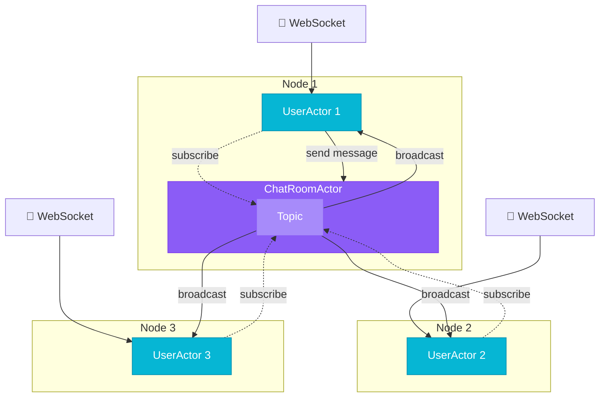

<table>
<tr>
<td width="15%">
  
</td>
<td>
  <h2>Actor Spring Boot Starter</h2>
  <p>Bring the power of the actor model to your Spring Boot applications with <a href="https://pekko.apache.org/">Pekko</a> (an open-source fork of Akka).</p>
</td>
</tr>
</table>

[](https://discord.com/channels/1439734161614045205/1439734162100846655)
[](https://seonwkim.github.io/actor-spring-boot-starter/)

## Why actor-spring-boot-starter?

I'm a Java developer, and I love using the actor model. However, Spring is everywhere in production. The goal of this project is to help Spring Boot projects easily integrate actor models with a great developer experience.

**Key Features:**

- Auto-configure the actor system within Spring Boot's context, with typed `spring.actor.*` properties
- Dependency injection for actors
- Simple cluster, sharding, singletons and cluster events as Spring `ApplicationEvent`s
- Actors on Spring `Executor` beans, and a Spring lifecycle (graceful shutdown, restart on a downed node)
- Metrics for actors and mailboxes (`actor-metrics`)
- Pekko stays an implementation detail: the API you compile against has no Pekko types

<div style="border: 2px solid #ccc; display: inline-block; border-radius: 8px; overflow: hidden; margin: 20px 0;">
  
</div>

With actor-spring-boot-starter, you can build stateful distributed systems without third-party middleware (e.g., Redis, Kafka).

Building AI agents? Each agent can be one sharded actor that keeps its own conversation, calls the model without blocking, and restarts under supervision. See the [AI Agents guide](https://seonwkim.github.io/actor-spring-boot-starter/guides/ai-agents/) and its runnable example in [`example/agent`](example/agent).

**Architecture** 



## Quick Start

### Prerequisites

- Java 21 or higher
- Spring Boot 3.5 or higher

Spring Boot 2 users stay on the 0.x line. See [CHANGELOG.md](CHANGELOG.md) for migrating from 0.x.

### Installation

Add the dependency to your project:

**Gradle:**

```gradle
implementation 'io.github.seonwkim:actor-spring-boot-starter:1.0.0'
```

**Maven:**

```xml
<dependency>
    <groupId>io.github.seonwkim</groupId>
    <artifactId>actor-spring-boot-starter</artifactId>
    <version>1.0.0</version>
</dependency>
```

For cluster features (sharding, singletons, cluster events, Pekko Management), depend on
`io.github.seonwkim:actor-spring-boot-starter-cluster` instead.

Spring Boot's dependency management already provides the Jackson version Pekko needs (2.18+), so no `jackson-bom` override is required.

### Enable Actor Support

Add `@EnableActorSupport` to your application:

```java

@SpringBootApplication
@EnableActorSupport
public class MyApplication {
    public static void main(String[] args) {
        SpringApplication.run(MyApplication.class, args);
    }
}
```

### Create Your First Actor

Create an actor by implementing `SpringActor`:

```java

@Component
public class GreeterActor implements SpringActor<GreeterActor.Command> {

    public interface Command {
    }

    public static class Greet extends AskCommand<String> implements Command {
        public final String name;

        public Greet(String name) {
            this.name = name;
        }
    }

    @Override
    public SpringActorBehavior<Command> create(SpringActorContext actorContext) {
        return SpringActorBehavior.builder(Command.class, actorContext)
                .onMessage(Greet.class, (ctx, msg) -> {
                    msg.reply("Hello, " + msg.name + "!");
                    return SpringActorBehavior.same();
                })
                .build();
    }
}
```

### Use Actors in Your Services

Inject `SpringActorSystem` and interact with actors:

```java

@Service
public class GreeterService {
    private final SpringActorSystem actorSystem;

    public GreeterService(SpringActorSystem actorSystem) {
        this.actorSystem = actorSystem;
    }

    public CompletionStage<String> greet(String name) {
        return actorSystem.getOrSpawn(GreeterActor.class, "greeter")
                .thenCompose(actor -> actor
                        .ask(new GreeterActor.Greet(name))
                        .withTimeout(Duration.ofSeconds(5))
                        .execute()
                );
    }
}
```

## Core Concepts

### Actor Lifecycle Management

**Spawn a New Actor:**

```java
// Create and start a new actor
CompletionStage<SpringActorHandle<Command>> actorHandle = actorSystem
                .actor(MyActor.class)
                .withId("my-actor-1")
                .withTimeout(Duration.ofSeconds(5))  // Optional
                .spawn();
```

**Get Existing Actor:**

```java
// Get reference to existing actor (returns null if not found)
CompletionStage<SpringActorHandle<Command>> actorHandle = actorSystem
                .get(MyActor.class, "my-actor-1");
```

**Get or Spawn (Recommended):**

```java
// Automatically gets existing or spawns new actor
CompletionStage<SpringActorHandle<Command>> actorHandle = actorSystem
                .getOrSpawn(MyActor.class, "my-actor-1");
```

**Check if Actor Exists:**

```java
CompletionStage<Boolean> exists = actorSystem
        .exists(MyActor.class, "my-actor-1");
```

**Stop an Actor:**

```java
actorHandle.thenAccept(actor -> actor.stop());
```

### Communication Patterns

**Fire-and-forget (tell):**

```java
actor.tell(new ProcessOrder("order-123"));
```

**Request-response (ask):**

```java
CompletionStage<String> response = actor
        .ask(new GetValue())
        .withTimeout(Duration.ofSeconds(5))
        .execute();
```

**With error handling:**

```java
CompletionStage<String> response = actor
        .ask(new GetValue())
        .withTimeout(Duration.ofSeconds(5))
        .onTimeout(() -> "default-value")
        .execute();
```

### Spring Dependency Injection

Actors are Spring components with full DI support:

```java

@Component
public class OrderActor implements SpringActor<OrderActor.Command> {

    private final OrderRepository orderRepository;

    public OrderActor(OrderRepository orderRepository) {
        this.orderRepository = orderRepository;
    }

    public interface Command {
    }

    public record ProcessOrder(String orderId) implements Command {
    }

    @Override
    public SpringActorBehavior<Command> create(SpringActorContext actorContext) {
        return SpringActorBehavior.builder(Command.class, actorContext)
                .onMessage(ProcessOrder.class, (ctx, msg) -> {
                    Order order = orderRepository.findById(msg.orderId);
                    // Process order...
                    return SpringActorBehavior.same();
                })
                .build();
    }
}
```

## Configuration

### Local Mode (Default)

Nothing to configure. Name the actor system if you like:

```yaml
spring:
  actor:
    name: orders
```

### Cluster Mode

With `actor-spring-boot-starter-cluster`:

```yaml
spring:
  actor:
    name: orders
    provider: cluster
    remote:
      hostname: 127.0.0.1
      port: 2551
    cluster:
      seed-nodes:
        - pekko://orders@127.0.0.1:2551
```

Every other Pekko setting can be set raw under `spring.actor.pekko.*` (for example
`spring.actor.pekko.loglevel: DEBUG`). See the [configuration guide](https://seonwkim.github.io/actor-spring-boot-starter/guides/configuration/).

## Advanced Features

### Sharded Actors (Cluster Mode)

For distributed systems, use sharded actors that are automatically distributed across cluster nodes:

**Define a Sharded Actor:**

```java

@Component
public class UserSessionActor implements SpringShardedActor<UserSessionActor.Command> {

    public static final ShardedEntityType<Command> TYPE =
            ShardedEntityType.of(Command.class, "UserSession");

    public interface Command extends JsonSerializable {
    }

    public record UpdateActivity(String activity) implements Command {
    }

    public static class GetActivity extends AskCommand<String> implements Command {
        public GetActivity() {
        }
    }

    @Override
    public ShardedEntityType<Command> entityType() {
        return TYPE;
    }

    @Override
    public SpringActorBehavior<Command> create(SpringShardedActorContext<Command> ctx) {
        return SpringActorBehavior.builder(Command.class, ctx)
                .withState(behaviorCtx -> new UserSession(ctx.getEntityId()))
                .onMessage(UpdateActivity.class, UserSession::onUpdateActivity)
                .onMessage(GetActivity.class, UserSession::onGetActivity)
                .build();
    }

    private static class UserSession {
        private final String userId;
        private String activity = "idle";

        UserSession(String userId) {
            this.userId = userId;
        }

        SpringActorBehavior<Command> onUpdateActivity(UpdateActivity msg) {
            this.activity = msg.activity();
            return SpringActorBehavior.same();
        }

        SpringActorBehavior<Command> onGetActivity(GetActivity msg) {
            msg.reply(activity);
            return SpringActorBehavior.same();
        }
    }
}
```

**Using Sharded Actors:**

```java
// Get reference (entity created on-demand)
SpringShardedActorHandle<Command> actor = actorSystem
                .sharded(UserSessionActor.class)
                .withId("user-123")
                .get();

// Fire-and-forget
actor.tell(new UpdateActivity("logged-in"));

// Request-response
CompletionStage<String> activity = actor
        .ask(new GetActivity())
        .withTimeout(Duration.ofSeconds(5))
        .execute();
```

**Key Differences from Regular Actors:**

- Created automatically when first message arrives (no `spawn()` needed)
- Always available, even if not currently running
- Automatically distributed across cluster nodes
- Passivated after idle timeout (configurable)
- Use `get()` to obtain reference (not `spawn()`)

### Supervision and Fault Tolerance

Build self-healing systems with supervision strategies:

**Available Strategies:**

```java
// Restart on failure (default)
SupervisionStrategy.restart()

// Restart with limit (e.g., 3 times within 1 minute)
SupervisionStrategy.restart().withLimit(3, Duration.ofMinutes(1))

// Stop on failure
SupervisionStrategy.stop()

// Resume and ignore failure
SupervisionStrategy.resume()
```

**Spawn Actors with Supervision:**

```java
// Top-level actor
actorSystem.actor(WorkerActor.class)
    .withId("worker-1")
    .withSupervisionStrategy(SupervisionStrategy.restart().withLimit(3, Duration.ofMinutes(1)))
    .spawn();
```

**Spawn Child Actors with Supervision:**

```java

@Component
public class SupervisorActor implements SpringActor<SupervisorActor.Command> {

    public interface Command {
    }

    @Override
    public SpringActorBehavior<Command> create(SpringActorContext actorContext) {
        return SpringActorBehavior.builder(Command.class, actorContext)
                .onMessage(DelegateWork.class, (ctx, msg) -> {
                    // Spawn supervised child
                    ctx.getSelf().child(WorkerActor.class)
                            .withId("worker-1")
                            .withSupervisionStrategy(SupervisionStrategy.restart())
                            .spawn();

                    return SpringActorBehavior.same();
                })
                .build();
    }
}
```

**Child Actor Operations:**

```java
// Spawn new child
CompletionStage<SpringActorHandle<Command>> child = parentRef
                .child(ChildActor.class)
                .withId("child-1")
                .spawn();

// Get existing child
CompletionStage<SpringActorHandle<Command>> existing = parentRef
        .child(ChildActor.class)
        .withId("child-1")
        .get();

// Get or spawn (recommended)
CompletionStage<SpringActorHandle<Command>> childRef = parentRef
        .child(ChildActor.class)
        .withId("child-1")
        .getOrSpawn();
```

## Running Examples

### Chat Application (Distributed)

Run a distributed chat application across multiple nodes:

```bash
# Start 3-node cluster on ports 8080, 8081, 8082
$ sh cluster-start.sh chat io.github.seonwkim.example.SpringPekkoApplication 8080 2551 3

# run frontend 
$ cd example/chat/frontend
$ npm run dev 

# Stop cluster
$ sh cluster-stop.sh
```

## Monitoring

Add `io.github.seonwkim:actor-metrics` for actor, mailbox and message metrics through Micrometer.

## Documentation

Full
documentation: [https://seonwkim.github.io/actor-spring-boot-starter/](https://seonwkim.github.io/actor-spring-boot-starter/)

## Community & Support

Join our community to ask questions, share ideas, and get help:

- **Discord**: [Join our Discord server](https://discord.com/channels/1439734161614045205/1439734162100846655) -
  Real-time chat with the community
- **Issues**: [GitHub Issues](https://github.com/seonWKim/actor-spring-boot-starter/issues) - Bug reports and feature
  requests
- **Discussions**: [GitHub Discussions](https://github.com/seonWKim/actor-spring-boot-starter/discussions) - Q&A and
  general discussions

## Contributing

Contributions welcome! Please:

1. Create an issue describing your contribution
2. Open a PR with clear explanation
3. Run `./gradlew spotlessApply` for formatting
4. Ensure tests pass

See [ARCHITECTURE.md](ARCHITECTURE.md) for how the modules fit together and [AGENTS.md](AGENTS.md) for the testing rules.

## License

This project is licensed under the Apache License 2.0.
