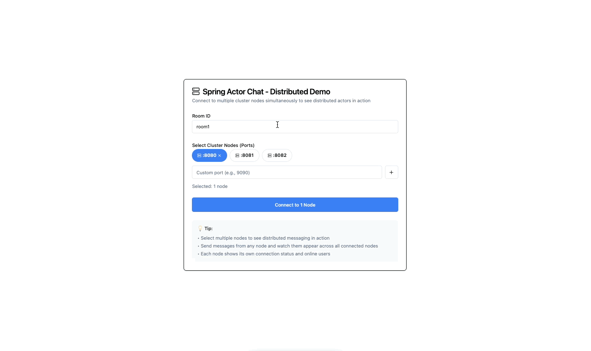

<table>
<tr>
<td width="15%">
  
</td>
<td>
  <h2>Actor Spring Boot Starter</h2>
  <p>The actor model for Spring Boot, on <a href="https://pekko.apache.org/">Apache Pekko</a> (the open-source fork of Akka).</p>
</td>
</tr>
</table>

[](https://central.sonatype.com/artifact/io.github.seonwkim/actor-spring-boot-starter)
[](https://seonwkim.github.io/actor-spring-boot-starter/)
[](https://discord.com/channels/1439734161614045205/1439734162100846655)

Actors are Spring beans. Spawn them, send them messages, and scale them across a cluster, without Pekko types in your code.
Build stateful services like chat, sessions, workflows and long-running AI agents without extra middleware.

- **Actors as beans:** dependency injection, `spring.actor.*` properties, Spring lifecycle and graceful shutdown
- **Messaging:** tell, ask with timeouts, supervision, timers, routers, pub/sub topics, receptionist
- **Cluster:** sharding, singletons, replicated data, split brain resolver; join through seed nodes, Kubernetes, a database or Redis
- **Data:** event-sourced actors and projections on your `DataSource`
- **Streaming:** Reactor `Mono`/`Flux`, SSE, WebSocket and gRPC
- **Production:** Actuator health, Micrometer metrics, tracing, Grafana dashboards, rolling/canary/blue-green deployments
- **Kotlin** coroutines, and an **`@ActorTest`** slice for tests



## Quick start

Java 21+ and Spring Boot 3.5+.

```gradle
implementation 'io.github.seonwkim:actor-spring-boot-starter:1.0.0'
```

```java
@SpringBootApplication
@EnableActorSupport
public class MyApplication {
    public static void main(String[] args) {
        SpringApplication.run(MyApplication.class, args);
    }
}

@Component
public class GreeterActor implements SpringActor<GreeterActor.Command> {
    public interface Command {}

    public static class Greet extends AskCommand<String> implements Command {
        public final String name;
        public Greet(String name) { this.name = name; }
    }

    @Override
    public SpringActorBehavior<Command> create(SpringActorContext actorContext) {
        return SpringActorBehavior.builder(Command.class, actorContext)
                .onMessage(Greet.class, (ctx, msg) -> {
                    msg.reply("Hello, " + msg.name + "!");
                    return SpringActorBehavior.same();
                })
                .build();
    }
}

@Service
public class GreeterService {
    private final SpringActorSystem actorSystem;

    public GreeterService(SpringActorSystem actorSystem) {
        this.actorSystem = actorSystem;
    }

    public CompletionStage<String> greet(String name) {
        return actorSystem.getOrSpawn(GreeterActor.class, "greeter")
                .thenCompose(greeter -> greeter.ask(new GreeterActor.Greet(name))
                        .withTimeout(Duration.ofSeconds(5))
                        .execute());
    }
}
```

The [getting started guide](https://seonwkim.github.io/actor-spring-boot-starter/getting-started/) walks through it.

## Modules

All are `io.github.seonwkim:<module>:1.0.0`.

| Module | Adds |
|---|---|
| `actor-spring-boot-starter` | Actor system, actors as beans, messaging |
| `actor-spring-boot-starter-cluster` | Cluster, sharding, singletons, replicated data |
| `actor-jdbc`, `actor-redis` | Cluster join and leases through a database or Redis |
| `actor-persistence`, `actor-projection` | Event-sourced actors and projections |
| `actor-streams` | Reactor, SSE, WebSocket and gRPC bridges |
| `actor-metrics` | Micrometer metrics |
| `actor-kotlin` | Kotlin coroutines and reified helpers |
| `actor-test` | `@ActorTest` and cluster test helpers |

Coming from 0.x (`spring-boot-starter-actor`)? See the [migration guide](https://seonwkim.github.io/actor-spring-boot-starter/migrating-from-0x/).

## Learn more

- [Documentation](https://seonwkim.github.io/actor-spring-boot-starter/): guides for every feature and a configuration reference
- [Examples](example): simple, cluster, chat, AI agents, persistence, Kubernetes, Kotlin and more
- [`llms.txt`](https://seonwkim.github.io/actor-spring-boot-starter/llms.txt) for AI assistants

## Community

- [Discord](https://discord.com/channels/1439734161614045205/1439734162100846655)
- [Issues](https://github.com/seonWKim/actor-spring-boot-starter/issues) and [Discussions](https://github.com/seonWKim/actor-spring-boot-starter/discussions)

## Contributing

Open an issue first, then a PR. Run `./gradlew spotlessApply build` before pushing.
[ARCHITECTURE.md](ARCHITECTURE.md) explains the modules, and [AGENTS.md](AGENTS.md) the testing rules.

## License

Apache License 2.0
