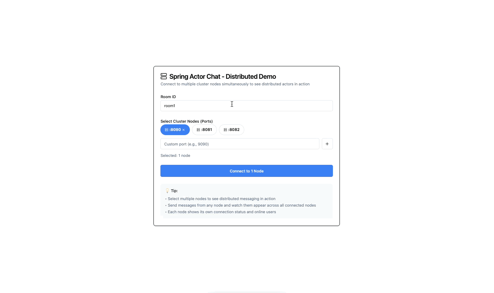

# Chat Example



This guide demonstrates how to build a real-time chat application using Actor Spring Boot Starter's pub/sub topics without introducing third-party middleware.

## Overview

The chat example shows how to:

- Build a real-time chat application using actors and pub/sub topics
- Implement WebSocket communication for real-time messaging
- Create a scalable, clustered chat system using distributed pub/sub
- Eliminate the need for external message brokers or middleware

This example demonstrates how Actor Spring Boot Starter can be used to build real-world applications efficiently without relying on additional infrastructure components.

!!! success "No External Dependencies"
    No Redis, RabbitMQ, or Kafka required! The actor system provides everything needed for distributed messaging.

## Source Code

You can find the complete source code for this example on GitHub:

[Chat Example Source Code](https://github.com/seonWKim/actor-spring-boot-starter/tree/main/example/chat)

!!! tip "Real-World Application"
    This example demonstrates patterns applicable to many real-time applications beyond chat.

## Key Components

### ChatRoomActor with Pub/Sub

`ChatRoomActor` is a sharded actor that manages a chat room using **pub/sub topics**. Each chat room creates a topic for message distribution, and users subscribe to receive messages. This eliminates the need to maintain a list of user actor references:

```java
@Component
public class ChatRoomActor implements SpringShardedActor<ChatRoomActor.Command> {

    public static final ShardedEntityType<Command> TYPE_KEY = ShardedEntityType.of(Command.class, "ChatRoomActor");

    private final SpringTopicManager topicManager;

    public ChatRoomActor(SpringTopicManager topicManager) {
        this.topicManager = topicManager;
    }

    /** Base interface for all commands that can be sent to the chat room actor. */
    public interface Command extends JsonSerializable {}

    /** Command to join a chat room. Provides actor ref for subscription. */
    public static class JoinRoom implements Command {
        public final String userId;
        public final SpringActorRef<UserActor.Command> userActorRef;

        public JoinRoom(String userId, SpringActorRef<UserActor.Command> userActorRef) {
            this.userId = userId;
            this.userActorRef = userActorRef;
        }
    }

    /** Command to leave a chat room. Provides actor ref for unsubscription. */
    public static class LeaveRoom implements Command {
        public final String userId;
        public final SpringActorRef<UserActor.Command> userActorRef;

        public LeaveRoom(String userId, SpringActorRef<UserActor.Command> userActorRef) {
            this.userId = userId;
            this.userActorRef = userActorRef;
        }
    }

    /** Command to send a message to the chat room. */
    public static class SendMessage implements Command {
        public final String userId;
        public final String message;

        public SendMessage(String userId, String message) {
            this.userId = userId;
            this.message = message;
        }
    }

    @Override
    public ShardedEntityType<Command> entityType() {
        return TYPE_KEY;
    }

    @Override
    public SpringActorBehavior<Command> create(SpringShardedActorContext<Command> ctx) {
        final String roomId = ctx.getEntityId();
        final SpringTopicRef<UserActor.Command> roomTopic = topicManager
                .topic(TopicName.of(UserActor.Command.class, "chat-room-" + roomId))
                .getOrCreate();

        return SpringActorBehavior.builder(Command.class, ctx)
                .withState(behaviorCtx -> new ChatRoomBehavior(behaviorCtx, roomId, roomTopic))
                .onMessage(JoinRoom.class, ChatRoomBehavior::onJoinRoom)
                .onMessage(LeaveRoom.class, ChatRoomBehavior::onLeaveRoom)
                .onMessage(SendMessage.class, ChatRoomBehavior::onSendMessage)
                .build();
    }

    /**
     * Behavior handler for chat room actor using pub/sub.
     * Creates a topic owned by this actor using SpringTopicManager.
     */
    private static class ChatRoomBehavior {
        private final SpringBehaviorContext<Command> ctx;
        private final String roomId;
        private final SpringTopicRef<UserActor.Command> roomTopic;

        ChatRoomBehavior(
                SpringBehaviorContext<Command> ctx, String roomId, SpringTopicRef<UserActor.Command> roomTopic) {
            this.ctx = ctx;
            this.roomId = roomId;
            this.roomTopic = roomTopic;
            ctx.getLog().info("Created pub/sub topic for chat room: {}", roomId);
        }

        /**
         * Handles JoinRoom commands by subscribing the user to the room topic.
         *
         * @param msg The JoinRoom message
         * @return The next behavior (same in this case)
         */
        private SpringActorBehavior<Command> onJoinRoom(JoinRoom msg) {

            // Subscribe the user to the room topic
            roomTopic.subscribe(msg.userActorRef);

            ctx.getLog().info("User {} joined room {}", msg.userId, roomId);

            // Notify all users that a new user has joined
            UserActor.JoinRoomEvent joinRoomEvent = new UserActor.JoinRoomEvent(msg.userId);
            roomTopic.publish(joinRoomEvent);

            return SpringActorBehavior.same();
        }

        /**
         * Handles LeaveRoom commands by unsubscribing the user from the room topic.
         *
         * @param msg The LeaveRoom message
         * @return The next behavior (same in this case)
         */
        private SpringActorBehavior<Command> onLeaveRoom(LeaveRoom msg) {

            // Unsubscribe the user from the topic
            roomTopic.unsubscribe(msg.userActorRef);

            ctx.getLog().info("User {} left room {}", msg.userId, roomId);

            // Notify all remaining users that a user has left
            UserActor.LeaveRoomEvent leaveRoomEvent = new UserActor.LeaveRoomEvent(msg.userId);
            roomTopic.publish(leaveRoomEvent);

            return SpringActorBehavior.same();
        }

        /**
         * Handles SendMessage commands by publishing the message to the room topic.
         *
         * @param msg The SendMessage message
         * @return The next behavior (same in this case)
         */
        private SpringActorBehavior<Command> onSendMessage(SendMessage msg) {
            ctx.getLog().debug("Broadcasting message from {} in room {}", msg.userId, roomId);

            // Create a message event
            UserActor.SendMessageEvent messageEvent = new UserActor.SendMessageEvent(msg.userId, msg.message);

            // Publish the message to all subscribers via the topic
            roomTopic.publish(messageEvent);

            return SpringActorBehavior.same();
        }
    }
}
```

### UserActor

`UserActor` represents a connected user. It subscribes to chat room topics and sends messages to the user's WebSocket connection:

```java
@Component
public class UserActor implements SpringActorWithContext<UserActor.Command, UserActor.UserActorContext> {

    public interface Command extends JsonSerializable {}

    public static class Connect implements Command {

        public Connect() {}
    }

    public static class JoinRoom implements Command {
        private final String roomId;

        @JsonCreator
        public JoinRoom(String roomId) {
            this.roomId = roomId;
        }

        public String getRoomId() {
            return roomId;
        }
    }

    public static class LeaveRoom implements Command {

        public LeaveRoom() {}
    }

    public static class SendMessage implements Command {
        private final String message;

        @JsonCreator
        public SendMessage(String message) {
            this.message = message;
        }

        public String getMessage() {
            return message;
        }
    }

    public static class JoinRoomEvent implements Command {
        private final String userId;

        @JsonCreator
        public JoinRoomEvent(String userId) {
            this.userId = userId;
        }

        public String getUserId() {
            return userId;
        }
    }

    public static class LeaveRoomEvent implements Command {
        private final String userId;

        @JsonCreator
        public LeaveRoomEvent(String userId) {
            this.userId = userId;
        }

        public String getUserId() {
            return userId;
        }
    }

    public static class SendMessageEvent implements Command {
        private final String userId;
        private final String message;

        @JsonCreator
        public SendMessageEvent(String userId, String message) {
            this.userId = userId;
            this.message = message;
        }

        public String getUserId() {
            return userId;
        }

        public String getMessage() {
            return message;
        }
    }

    public static class UserActorContext extends SpringActorContext {
        private final SpringActorSystem actorSystem;
        // The WebSocket client: JSON events sent here go to the browser.
        private final SpringActorRef<String> client;

        private final String userId;

        public UserActorContext(SpringActorSystem actorSystem, String userId, SpringActorRef<String> client) {
            this.actorSystem = actorSystem;
            this.userId = userId;
            this.client = client;
        }

        @Override
        public String actorId() {
            return userId;
        }
    }

    @Override
    public SpringActorBehavior<Command> create(UserActorContext actorContext) {
        return SpringActorBehavior.builder(Command.class, actorContext)
                .withState(ctx -> {
                    // The client reference stops when the browser disconnects; this actor stops with it.
                    ctx.watch(actorContext.client);
                    return new UserActorBehavior(ctx, actorContext.actorSystem, actorContext.userId, actorContext.client);
                })
                .onMessage(Connect.class, UserActorBehavior::onConnect)
                .onMessage(JoinRoom.class, UserActorBehavior::onJoinRoom)
                .onMessage(LeaveRoom.class, UserActorBehavior::onLeaveRoom)
                .onMessage(SendMessage.class, UserActorBehavior::onSendMessage)
                .onMessage(JoinRoomEvent.class, UserActorBehavior::onJoinRoomEvent)
                .onMessage(LeaveRoomEvent.class, UserActorBehavior::onLeaveRoomEvent)
                .onMessage(SendMessageEvent.class, UserActorBehavior::onSendMessageEvent)
                .onSignal(ActorTerminated.class, (behavior, signal) -> SpringActorBehavior.stopped())
                .build();
    }

    public static class UserActorBehavior {
        private final SpringBehaviorContext<Command> context;
        private final SpringActorSystem actorSystem;

        private final String userId;
        private final SpringActorRef<String> client;

        @Nullable private String currentRoomId;

        public UserActorBehavior(
                SpringBehaviorContext<Command> context,
                SpringActorSystem actorSystem,
                String userId,
                SpringActorRef<String> client) {
            this.context = context;
            this.actorSystem = actorSystem;
            this.userId = userId;
            this.client = client;
        }

        private SpringActorBehavior<Command> onConnect(Connect connect) {
            sendEvent("connected", json -> {
                json.append(",\"userId\":\"").append(escapeJson(userId)).append("\"");
            });

            return SpringActorBehavior.same();
        }

        private SpringActorBehavior<Command> onJoinRoom(JoinRoom command) {
            currentRoomId = command.getRoomId();
            final var roomActor = getRoomActor();
            sendEvent("joined", json -> {
                json.append(",\"roomId\":\"").append(escapeJson(currentRoomId)).append("\"");
            });

            // TODO: how can we send SpringActorHandle across the clusters?
            // currently we have schedulers as field under the ref, that's why it's hard to send it across the cluster
            // because we now have to serde scheduler which isn't possible(and shouldn't be)
            roomActor.tell(new ChatRoomActor.JoinRoom(userId, context.getSelf()));
            return SpringActorBehavior.same();
        }

        private SpringActorBehavior<Command> onLeaveRoom(LeaveRoom command) {
            if (currentRoomId == null) {
                context.getLog().info("{} user has not joined any room.", userId);
                return SpringActorBehavior.same();
            }

            sendEvent("left", json -> {
                json.append(",\"roomId\":\"").append(escapeJson(currentRoomId)).append("\"");
            });

            final var roomActor = getRoomActor();
            roomActor.tell(new ChatRoomActor.LeaveRoom(userId, context.getSelf()));

            return SpringActorBehavior.same();
        }

        private SpringActorBehavior<Command> onSendMessage(SendMessage command) {
            if (currentRoomId == null) {
                context.getLog().info("{} user has not joined any room.", userId);
                return SpringActorBehavior.same();
            }

            final var roomActor = getRoomActor();
            roomActor.tell(new ChatRoomActor.SendMessage(userId, command.getMessage()));

            return SpringActorBehavior.same();
        }

        private SpringActorBehavior<Command> onJoinRoomEvent(JoinRoomEvent event) {
            sendEvent("user_joined", json -> {
                json.append(",\"userId\":\"")
                        .append(escapeJson(event.getUserId()))
                        .append("\"");
                json.append(",\"roomId\":\"").append(escapeJson(currentRoomId)).append("\"");
            });
            return SpringActorBehavior.same();
        }

        private SpringActorBehavior<Command> onLeaveRoomEvent(LeaveRoomEvent event) {
            sendEvent("user_left", json -> {
                json.append(",\"userId\":\"")
                        .append(escapeJson(event.getUserId()))
                        .append("\"");
                json.append(",\"roomId\":\"").append(escapeJson(currentRoomId)).append("\"");
            });
            return SpringActorBehavior.same();
        }

        private SpringActorBehavior<Command> onSendMessageEvent(SendMessageEvent event) {
            sendEvent("message", json -> {
                json.append(",\"userId\":\"")
                        .append(escapeJson(event.getUserId()))
                        .append("\"");
                json.append(",\"message\":\"")
                        .append(escapeJson(event.getMessage()))
                        .append("\"");
                json.append(",\"roomId\":\"").append(escapeJson(currentRoomId)).append("\"");
            });
            return SpringActorBehavior.same();
        }

        private SpringShardedActorHandle<ChatRoomActor.Command> getRoomActor() {
            return actorSystem
                    .sharded(ChatRoomActor.class)
                    .withId(currentRoomId)
                    .get();
        }

        private void sendEvent(String type, EventBuilder builder) {
            try {
                // Build JSON string directly to avoid blocking Jackson serialization
                StringBuilder json = new StringBuilder();
                json.append("{\"type\":\"").append(escapeJson(type)).append("\"");

                builder.build(json);

                json.append("}");
                client.tell(json.toString());
            } catch (Exception e) {
                context.getLog().error("Failed to send message to WebSocket", e);
            }
        }

        /**
         * Escape JSON string values to prevent injection and ensure valid JSON.
         * This is a simple escaping for common characters.
         */
        private String escapeJson(String value) {
            if (value == null) return "";
            return value.replace("\\", "\\\\")
                    .replace("\"", "\\\"")
                    .replace("\n", "\\n")
                    .replace("\r", "\\r")
                    .replace("\t", "\\t");
        }

        @FunctionalInterface
        private interface EventBuilder {
            void build(StringBuilder json);
        }
    }
}
```

### WebSocket endpoint

`ChatWebSocketHandler` connects each WebSocket connection to a new `UserActor` through the
[`ActorWebSocketHandler`](../guides/streaming-to-clients.md) bridge from `actor-streams`. The bridge creates the
`client` reference the user actor sends to; the handler turns each JSON frame from the browser into a
`UserActor` command. When the browser disconnects, the `client` reference stops, and the user actor, which
watches it, stops too.

```java
this.bridge = new ActorWebSocketHandler(streams, (session, client) -> actorSystem
        .actor(UserActor.class)
        .withContext(new UserActor.UserActorContext(actorSystem, UUID.randomUUID().toString(), client))
        .spawn()
        .thenApply(this::connect));

private Consumer<String> connect(SpringActorHandle<UserActor.Command> user) {
    user.tell(new Connect());
    return payload -> {
        UserActor.Command command = parse(payload); // JoinRoom, LeaveRoom or SendMessage
        if (command != null) {
            user.tell(command);
        }
    };
}
```

## Architecture with Pub/Sub

### Benefits of Pub/Sub Approach

The pub/sub implementation provides several advantages:

1. **Simplified State Management** - No need to maintain a list of user actor references
2. **Automatic Cleanup** - Users are automatically unsubscribed when their actors terminate
3. **Scalability** - Topics work seamlessly across cluster nodes
4. **Decoupled Communication** - Publishers don't need to know about subscribers
5. **Location Transparency** - Works the same whether actors are local or distributed

!!! info "Pub/Sub vs Direct Messaging"
    Pub/sub is ideal for one-to-many communication patterns. For point-to-point messaging, use direct actor references instead.

### Message Flow

```
1. User connects → UserActor created
2. User joins room → UserActor tells ChatRoomActor
3. ChatRoomActor subscribes UserActor to room topic
4. User sends message → ChatRoomActor publishes to topic
5. All subscribed UserActors receive message via topic
6. UserActors forward to WebSocket clients
```

### Cluster Serialization

Messages that carry a reply address declare a `SpringActorRef<T>` field. It serializes across the
cluster, so a user actor on one node can join a room that lives on another:

```java
roomActor.tell(new ChatRoomActor.JoinRoom(userId, context.getSelf()));
```

The messages themselves implement `JsonSerializable`, as every message sent between nodes must.

## Running the Application

### Local Cluster Setup

You can run multiple instances of the application locally using Gradle:

```bash
# Run the server app 
sh cluster-start.sh chat io.github.seonwkim.example.SpringPekkoApplication 8080 2551 3

# Run the frontend app  
cd example/chat/frontend 
npm run dev 
```

## Architecture Benefits

This architecture eliminates the need for third-party middleware by leveraging:

- **Distributed pub/sub topics** for message distribution
- **Sharded actors** for scalability and fault tolerance
- **Built-in message routing** between actors
- **Natural state management** within actors
- **Real-time communication** via WebSockets
- **Automatic cleanup** and lifecycle management

!!! success "Production Ready"
    This architecture is production-ready and can scale to thousands of concurrent users across multiple nodes.

## Key Takeaways

- Pub/sub topics provide a clean abstraction for one-to-many communication
- The actor model combined with pub/sub creates an efficient, scalable messaging system
- WebSockets and actors work together seamlessly for real-time applications
- No external message broker required - everything is built into the framework
- Cluster-aware topics distribute messages automatically across nodes

## Next Steps

- [Pub/Sub Topics Guide](../guides/pub-sub-topics.md) - Deep dive into pub/sub concepts
- [Cluster Example](cluster.md) - Learn about cluster sharding
