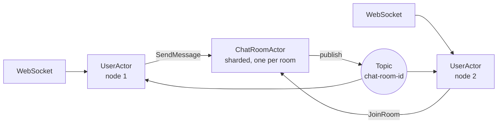

# Chat Example

A clustered chat app. Each browser connection gets its own actor, each chat room is a sharded actor, and
room messages go to every member through a pub/sub topic, across nodes, with no message broker.

- **Source:** [`example/chat`](https://github.com/seonWKim/actor-spring-boot-starter/tree/main/example/chat)
- **Runs:** three nodes on one machine, in Docker Compose, or on Kubernetes ([Kubernetes example](kubernetes.md))
- **Modules:** `actor-spring-boot-starter-cluster`, `actor-streams` (WebSocket bridge), `actor-metrics`,
  Spring WebFlux, Actuator with Prometheus; a React frontend in `frontend/`

## What it shows

- One actor per WebSocket connection, with `ActorWebSocketHandler` from `actor-streams`
- A sharded actor per chat room
- Pub/sub topics (`SpringTopicManager`) to broadcast to every member of a room, on any node
- `watch` and `ActorTerminated`: the user actor stops when the browser disconnects
- Sending to a room from a REST endpoint, outside any WebSocket
- A custom Actuator endpoint that reads the Pekko cluster state



## Run it

The frontend is not built by default. Build it once so Spring Boot serves it from
`src/main/resources/static`:

```bash
cd example/chat/frontend
npm install
npm run build
```

`bootRun` builds the `actor-metrics` Java agent jar and attaches it. One node, from the repository root:

```bash
./gradlew :example:chat:bootRun
```

Three nodes, with the `cluster-start.sh` script in the repository root:

```bash
sh cluster-start.sh chat io.github.seonwkim.example.SpringPekkoApplication 8080 2551 3
```

Open `http://localhost:8080`, `http://localhost:8081` and `http://localhost:8082` in three tabs, join the
same room in each, and send messages. Stop the nodes with `sh cluster-stop.sh`.

For frontend work, `npm run dev` in `frontend/` serves the UI on `http://localhost:5173` and proxies
`/ws` and `/api` to the node on port 8080.

### With Docker Compose

```bash
cd example/chat
sh init-local-docker.sh
```

The script builds the jar and the `chat-app:latest` image and starts three containers (`chat-app-0` to
`chat-app-2`) on ports 8080 to 8082. They find each other through the `SEED_NODES` environment
variable.

### Send messages from the command line

`POST /api/chat/send` sends a message to a room without a WebSocket. `send-random-messages.sh` uses it
for load tests:

```bash
curl -X POST http://localhost:8080/api/chat/send \
  -H "Content-Type: application/json" \
  -d '{"roomId":"room1","userId":"bot","message":"hello"}'

cd example/chat
./send-random-messages.sh room1 -w 50 -r 20 -m 1000 -b   # 1,000 messages, 50 workers, 20 random users
./send-random-messages.sh --help
```

## Walkthrough

### The WebSocket endpoint: `ChatWebSocketHandler`

`ActorWebSocketHandler` connects each WebSocket session to actors. For every new session it calls the
connector with a `client` reference: text sent to `client` goes to the browser. The connector returns
where the browser's text frames go.

```java
public ChatWebSocketHandler(ObjectMapper objectMapper, SpringActorSystem actorSystem, ActorStreams streams) {
    this.objectMapper = objectMapper;
    this.bridge = new ActorWebSocketHandler(streams, (session, client) -> actorSystem
            .actor(UserActor.class)
            .withContext(new UserActor.UserActorContext(actorSystem, UUID.randomUUID().toString(), client))
            .spawn()
            .thenApply(this::connect));
}

@Override
public Mono<Void> handle(WebSocketSession session) {
    return bridge.handle(session);
}

private Consumer<String> connect(SpringActorHandle<UserActor.Command> user) {
    user.tell(new Connect());
    return payload -> {
        UserActor.Command command = parse(payload);
        if (command != null) {
            user.tell(command);
        }
    };
}
```

`parse` reads the JSON frame's `type` (`join`, `leave`, `message`) and turns it into a `UserActor`
command. `WebSocketConfig` maps the handler to `/ws/chat`.

### One actor per connection: `UserActor`

`UserActor` gets its user id and the `client` reference through a custom context
(`SpringActorWithContext` with `UserActorContext`). It watches `client`; when the browser disconnects,
the reference stops and the actor stops too:

```java
@Override
public SpringActorBehavior<Command> create(UserActorContext actorContext) {
    return SpringActorBehavior.builder(Command.class, actorContext)
            .withState(ctx -> {
                ctx.watch(actorContext.client);
                return new UserActorBehavior(ctx, actorContext.actorSystem, actorContext.userId, actorContext.client);
            })
            .onMessage(JoinRoom.class, UserActorBehavior::onJoinRoom)
            .onMessage(SendMessage.class, UserActorBehavior::onSendMessage)
            .onMessage(SendMessageEvent.class, UserActorBehavior::onSendMessageEvent)
            // ... Connect, LeaveRoom, JoinRoomEvent, LeaveRoomEvent
            .onSignal(ActorTerminated.class, (behavior, signal) -> SpringActorBehavior.stopped())
            .build();
}
```

Commands from the browser (`JoinRoom`, `SendMessage`) go to the room actor. Events from the room
(`JoinRoomEvent`, `SendMessageEvent`, ...) become JSON text sent to `client.tell(json)`. To join, the user
actor passes its own reference so the room can subscribe it:

```java
roomActor.tell(new ChatRoomActor.JoinRoom(userId, context.getSelf()));
```

### One sharded actor per room: `ChatRoomActor`

Each room is a sharded entity that owns a topic named `chat-room-<roomId>`. The topic manager is injected
into the actor bean:

```java
@Override
public SpringActorBehavior<Command> create(SpringShardedActorContext<Command> ctx) {
    final String roomId = ctx.getEntityId();
    final SpringTopicRef<UserActor.Command> roomTopic = topicManager
            .topic(TopicName.of(UserActor.Command.class, "chat-room-" + roomId))
            .getOrCreate();

    return SpringActorBehavior.builder(Command.class, ctx)
            .withState(behaviorCtx -> new ChatRoomBehavior(behaviorCtx, roomId, roomTopic))
            .onMessage(JoinRoom.class, ChatRoomBehavior::onJoinRoom)
            .onMessage(LeaveRoom.class, ChatRoomBehavior::onLeaveRoom)
            .onMessage(SendMessage.class, ChatRoomBehavior::onSendMessage)
            .build();
}
```

Joining subscribes the user actor to the topic; a message is published once and reaches every
subscriber, on every node:

```java
private SpringActorBehavior<Command> onJoinRoom(JoinRoom msg) {
    roomTopic.subscribe(msg.userActorRef);
    roomTopic.publish(new UserActor.JoinRoomEvent(msg.userId));
    return SpringActorBehavior.same();
}

private SpringActorBehavior<Command> onSendMessage(SendMessage msg) {
    roomTopic.publish(new UserActor.SendMessageEvent(msg.userId, msg.message));
    return SpringActorBehavior.same();
}
```

Every command that crosses nodes implements `JsonSerializable`, including `JoinRoom`, which carries a
`SpringActorRef`.

### Sending from outside: `ChatMessageSenderService`

Any Spring bean can send to a room by id:

=== "Java"

    ```java
    SpringShardedActorHandle<ChatRoomActor.Command> roomRef =
            springActorSystem.sharded(ChatRoomActor.class).withId(roomId).get();
    roomRef.tell(new ChatRoomActor.SendMessage(userId, message));
    ```

=== "Kotlin"

    ```kotlin
    actorSystem.sharded<ChatRoomActor, _>()
        .withId(roomId)
        .get()
        .tell(ChatRoomActor.SendMessage(userId, message))
    ```

### Operations extras

- `ActorClusterStateEndpoint` adds `/actuator/actor-cluster-state`, which lists the cluster members and
  their status. It reads Pekko's `Cluster` through `springActorSystem.unwrap(Cluster.class)`, which is why
  the build declares Pekko Cluster directly.
- `metrics/ClusterShardingMetricsExporter` asks Pekko's shard state every second and exports a
  `pekko.shard.entities` gauge per shard for `HelloActor`.
- `/actuator/prometheus` exposes the actor meters. Set `ACTOR_METRICS_ENABLED=false` to turn off the
  agent's metrics (see `config/ActorMetricsConfiguration`).
- `config/BlockHoundConfiguration` installs BlockHound when you start the JVM with
  `-Dblockhound.enabled=true`, to catch blocking calls on actor dispatcher threads.
- The app also has the cluster example's sharded `HelloActor` at `GET /hello?message=...&entityId=...`.
  The Kubernetes example's load script uses it.

## Try next

- Open the same room on two nodes, then stop one node (`kill $(lsof -t -i:8081)`). The room entity moves
  to a remaining node if it was on the stopped one; users on the remaining nodes rejoin and keep
  chatting.
- Run `send-random-messages.sh` in burst mode and watch `/actuator/prometheus` on each node.
- Close a browser tab and check the log: the `UserActor` for that connection stops.
- Deploy it to Kubernetes with the [Kubernetes example](kubernetes.md).

## Related

- [Pub/sub topics](../guides/core/pub-sub-topics.md)
- [Sharded actors](../guides/cluster/sharded-actors.md)
- [Streaming to clients](../guides/streaming/streaming-to-clients.md): `ActorWebSocketHandler`, SSE and gRPC
- [Behaviors](../guides/core/behaviors.md): `watch` and `ActorTerminated`
- [Monitoring](../guides/operations/monitoring.md)
